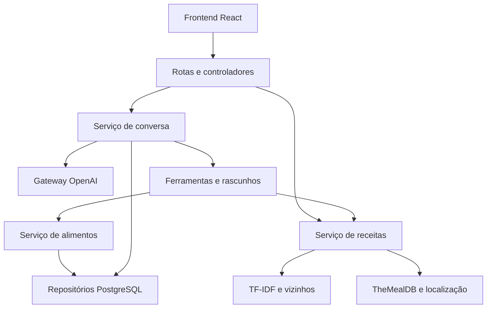

# Arquitetura da parte revisada

## Fluxo e limites de responsabilidade

O frontend não decide regras de estoque. A OpenAI interpreta a mensagem e solicita ferramentas; o backend valida os argumentos, prepara a proposta e controla a confirmação. O recomendador recebe dados e retorna um ranking sem executar SQL ou chamadas HTTP.

## Arquivos do chatbot

| Arquivo | Responsabilidade |
| --- | --- |
| `controllers/chat.controller.ts` | Validar formato HTTP, usar identidade autenticada e encaminhar respostas/erros |
| `routes/chat.routes.ts` | Rotas, middleware JWT e especificação Swagger |
| `chat/chat.service.ts` | Orquestrar conversa, contexto e execução de decisões do usuário |
| `chat/chat.openai.ts` | Contrato de ferramentas, instruções e transporte da OpenAI |
| `chat/chat.tools.ts` | Adaptar chamadas de ferramentas às operações de estoque/receitas |
| `chat/chat.draft.ts` | Campos obrigatórios, perguntas, transições de cadastro e opção de juntar lotes |
| `chat/chat.stock.ts` | Normalização de nomes, correspondência e planejamento de consumo por validade |
| `chat/chat.validation.ts` | Interpretação determinística de números, datas, locais e comandos |
| `chat/chat.presentation.ts` | Formatar respostas, medidas e receitas |
| `chat/chat.repository.ts` | Persistir sessão, contexto e mensagens; buscar histórico |
| `chat/chat.types.ts` | Contratos de rascunho, proposta, resultado e contexto |

O histórico recupera as 200 mensagens mais recentes em ordem cronológica; a janela de contexto da conversa continua limitada a 12 mensagens.

## Persistência e regras

- SQL de sessões/mensagens fica no repositório do chat.
- SQL de consumo em múltiplos lotes fica no repositório de alimentos e usa transação, com rollback em caso de falha.
- Cada consulta/alteração de estoque usa o `userId` da autenticação. O modelo não escolhe o usuário atendido.
- `FoodService` permanece responsável pela validação antes das gravações.
- `pending_action` guarda um rascunho, escolha de lote ou proposta de alteração. Só a confirmação executa a proposta.
- Limpar a conversa remove mensagens, contexto de receitas e ação pendente, sem excluir os alimentos.

## Dependências e testabilidade

`createChatService(ChatDependencies)` permite fornecer contratos pequenos para repositório, serviços e modelo de linguagem. `createChatRepository` também recebe o acesso ao banco como dependência. As implementações reais são o padrão; os testes substituem essas dependências sem modificar métodos globais ou precisar de rede.

Isso aplica responsabilidade única, segregação de contratos e inversão de dependências na parte revisada. Tipos e funções puras são usados onde uma classe adicional não traria benefício. A enumeração de ferramentas continua explícita: adicionar uma nova operação exige atualizar o contrato e seu tratamento.

## ML e receitas

`RecipeService` recupera candidatos na TheMealDB, faz uma pré-seleção de até 24 receitas e chama `rankRecipesWithML`. O cliente `services/mealdb.client.ts` isola o transporte HTTP: prazo por tentativa, repetição limitada de falhas temporárias e cache público em memória. O serviço limita buscas/detalhes a três requisições simultâneas e mantém os resultados parciais obtidos. A busca de candidatos e detalhes tem prazo conjunto de 20 segundos, anterior à localização e ao ranking.

O módulo `ml/tfidf.ts` ajusta o vocabulário/IDF no corpus de candidatos e transforma receitas e consulta. `ml/recipe-recommender.ts` prepara o estoque, calcula distâncias e seleciona os k vizinhos.

A localização para português e o cache vêm depois do ranking. O dicionário de ingredientes é uma regra explícita de normalização; não é apresentado como um classificador aprendido.

## Limites atuais

A confirmação e a gravação da proposta não possuem um protocolo completo de concorrência entre sessões/dispositivos. Evite manter propostas abertas enquanto altera o mesmo estoque por outra tela; uma solução de produção deve acrescentar versionamento e confirmação atômica. Esta revisão não implementa autenticação administrativa nem uma arquitetura distribuída.
